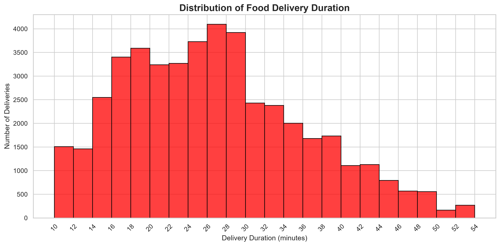
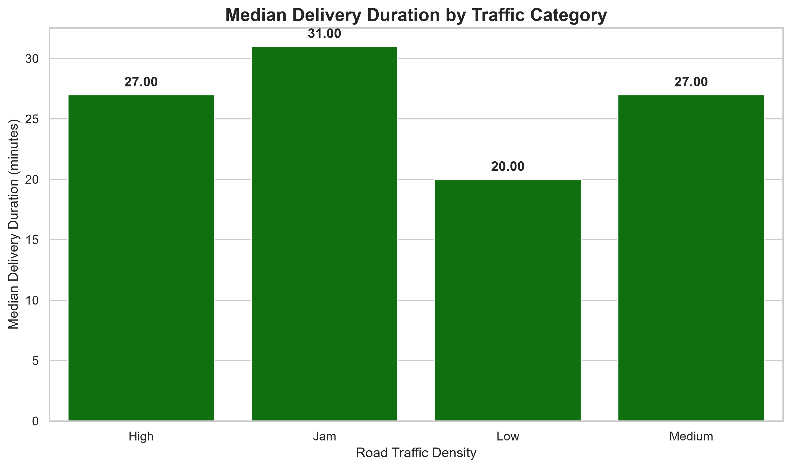
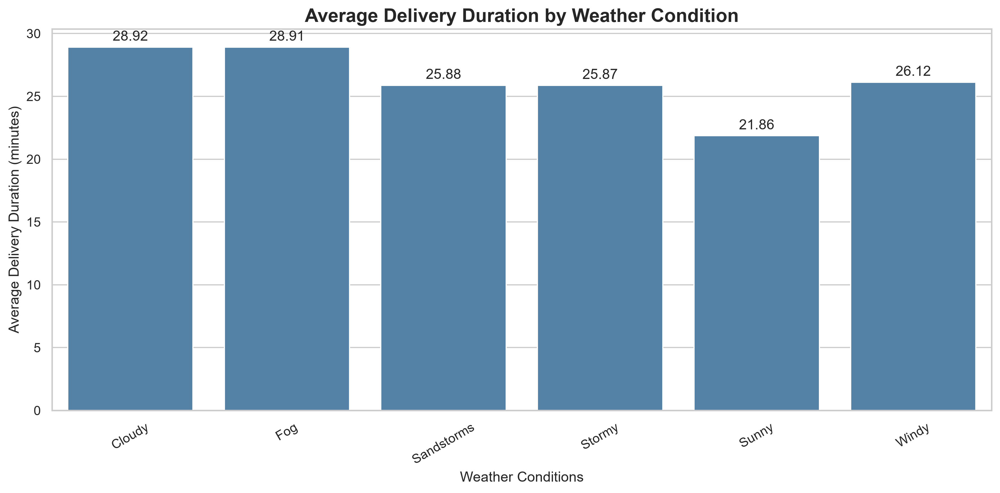
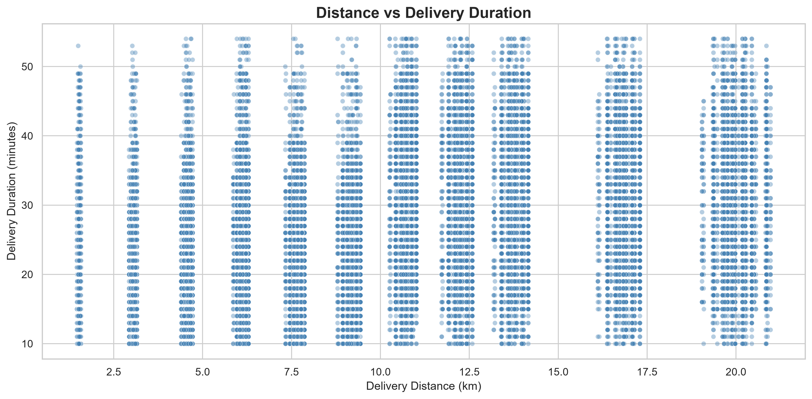
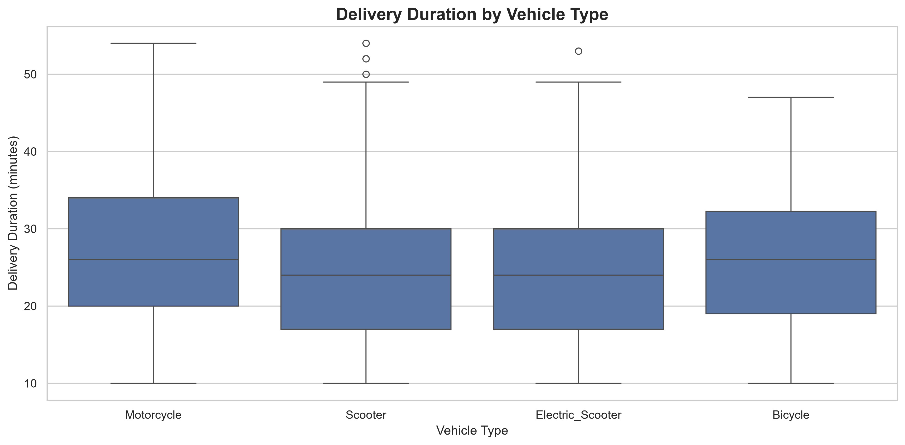

# Food Delivery Data Analysis

## Project Overview

This project focuses on analyzing a Food Delivery dataset containing 45,584 delivery records and 20 columns.

The objective is to clean the dataset, perform Exploratory Data Analysis (EDA), identify important patterns, and visualize factors that may affect food delivery duration.

## Tools and Technologies

- Python
- Pandas
- NumPy
- Matplotlib
- Seaborn
- Jupyter Notebook
- Git and GitHub

# Week 1: Data Understanding and Cleaning

## Objective

The objective of Week 1 was to understand the dataset, identify data quality issues, clean the data, and prepare it for further analysis.

## Dataset Information

- Total records: 45,584
- Total columns: 20
- Dataset type: Food Delivery Data

## Data Cleaning Tasks

- Inspected dataset structure and data types.
- Identified missing values.
- Checked and removed duplicate records where necessary.
- Checked duplicate IDs.
- Corrected inconsistent city spelling (`Metropolitian` to `Metropolitan`).
- Standardized date formats.
- Converted `Order_Date` into datetime format.
- Investigated missing and inconsistent values.

## Cleaning Results

- Original dataset: 45,584 rows and 20 columns.
- Duplicate rows: 0.
- Duplicate IDs: 0.
- Missing values after cleaning: 9,184.
- Corrected city spelling in 34,087 records.
- Exported the cleaned dataset as `cleaned_food_delivery.csv`.

## Week 1 Outcome

The dataset was inspected and cleaned for further Exploratory Data Analysis.

---

# Week 2: Exploratory Data Analysis (EDA)

## Objective

The objective of Week 2 was to explore the cleaned dataset and understand the relationship between delivery duration and different factors.

## Analysis Performed

- Delivery duration analysis.
- Road traffic density analysis.
- Weather conditions analysis.
- Vehicle type analysis.
- Statistical summaries using Pandas.
- Grouping and aggregation operations.

## Traffic Analysis Results

 Traffic Category , Average Duration , Median Duration , Deliveries 

| High | 27.24 min | 27 min | 4,423 |
| Jam | 31.18 min | 31 min | 14,139 |
| Low | 21.27 min | 20 min | 15,476 |
| Medium | 26.70 min | 27 min | 10,945 |

### Key Findings

- Jam traffic recorded the highest average delivery duration of 31.18 minutes.
- Low traffic recorded the lowest average duration of 21.27 minutes.
- Traffic conditions showed differences in delivery duration.

## Weather Analysis Results

 Weather Condition , Average Duration , Median Duration , Deliveries 

| Cloudy | 28.92 min | 28 min | 7,533 |
| Fog | 28.91 min | 28 min | 7,653 |
| Sandstorms | 25.88 min | 26 min | 7,494 |
| Stormy | 25.87 min | 26 min | 7,584 |
| Sunny | 21.86 min | 20 min | 7,282 |
| Windy | 26.12 min | 26 min | 7,422 |

### Key Findings

- Cloudy weather had the highest average delivery duration of 28.92 minutes.
- Sunny weather had the lowest average delivery duration of 21.86 minutes.
- Weather conditions showed an association with delivery duration.

## Week 2 Outcome

EDA helped identify patterns, understand data distributions, and explore how traffic and weather conditions relate to food delivery duration.

---

# Week 3: Data Visualization and Analysis

## Objective

The objective of Week 3 was to create meaningful visualizations to understand delivery duration patterns and relationships.

## Visualizations Created

### 1. Delivery Duration Distribution

A histogram was created to understand the distribution of food delivery durations using 2-minute intervals.

### 2. Traffic Comparison

A bar chart was created to compare median delivery duration across different traffic categories.

### 3. Weather Comparison

A bar chart was created to compare average delivery duration across different weather conditions.

### 4. Distance vs Delivery Duration

A scatter plot was created to investigate the relationship between delivery distance and delivery duration.

The Haversine formula was used to calculate geographical distances using restaurant and delivery location coordinates.

Records with calculated distances above 50 km were excluded from this visualization.

### 5. Vehicle Comparison

A box plot was created to compare delivery duration across different vehicle types.

## Vehicle Analysis Results

Vehicle Type , Average Duration ,Median Duration , Deliveries 

| Bicycle | 26.43 min | 26 min | 68 |
| Electric Scooter | 24.47 min | 24 min | 3,814 |
| Motorcycle | 27.61 min | 26 min | 26,429 |
| Scooter | 24.48 min | 24 min | 15,273 |

## Key Findings

- Motorcycle deliveries had the highest average duration of 27.61 minutes.
- Scooter deliveries had the lowest average duration of 24.48 minutes.
- Cloudy weather had the highest average delivery duration.
- Jam traffic had the highest median delivery duration.
- A total of 431 records with calculated distances above 50 km were excluded from the distance visualization.

## Week 3 Outcome

Five visualizations were created using Matplotlib and Seaborn to communicate important patterns and findings from the dataset.

# Final Project Conclusion

This project provided practical experience in the data analysis process, including data understanding, data cleaning, exploratory data analysis, statistical analysis, and data visualization.

The analysis helped identify how delivery duration varies across traffic categories, weather conditions, vehicle types, and delivery distances.

## Skills Learned

- Data Cleaning and Preprocessing
- Exploratory Data Analysis (EDA)
- Data Manipulation using Pandas
- Numerical Analysis using NumPy
- Data Visualization using Matplotlib and Seaborn
- Statistical Analysis
- Git and GitHub

# Author
Mohsin Saad

**Note:** The notebook names above reflect the existing project files. The visualization images are stored in the `visualizations` folder.
